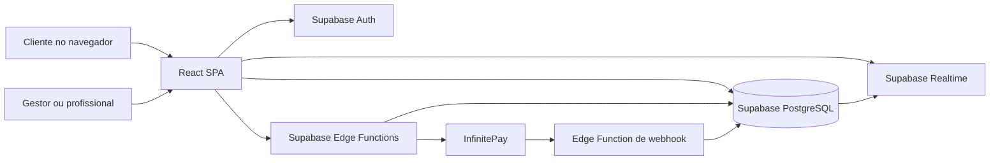

# Visão geral

## Propósito

QuickBarber é uma aplicação web de gestão e agendamento criada para barbearias.
Reúne agendamento público, administração da barbearia, agenda, comandas/PDV,
caixa, clientes, catálogo de serviços e pagamentos.

O sistema tem uma interface compartilhada por múltiplas barbearias. Os
registros operacionais são associados a uma barbearia (`barbershop_id`); o
acesso efetivo aos registros também depende das políticas de Row Level Security
(RLS) do Supabase e das regras aplicadas pela aplicação.

## Visão lógica



## Componentes e responsabilidades

| Componente | Responsabilidade |
| --- | --- |
| SPA React | Interface pública e autenticada, roteamento, formulários e módulos de gestão. |
| Supabase Auth | Sessão e identidade dos usuários. |
| Supabase PostgreSQL | Persistência de barbearias, usuários, agendamentos, catálogo, financeiro e demais dados. |
| RLS e funções SQL | Restrições de acesso e operações atômicas no banco, conforme as políticas e migrações instaladas. |
| Supabase Realtime | Notifica o painel sobre mudanças em agendamentos e clientes. |
| Supabase Edge Functions | Operações server-side que usam credenciais privadas e integrações externas. |
| InfinitePay | Provedor externo usado em fluxos de checkout/PIX e notificações de pagamento. |
| Vite PWA | Geração de manifest e service worker para instalação como aplicação web. |

## Tecnologias observadas

- Frontend: React 18, TypeScript, Vite e React Router.
- Componentes e estilos: Tailwind CSS, shadcn/ui e Radix UI.
- Estado de servidor: TanStack React Query.
- Backend gerenciado: Supabase Auth, PostgreSQL, RLS, Realtime e Edge Functions em Deno.
- Pagamentos: InfinitePay.
- Testes: Vitest e Playwright.
- Hospedagem SPA: configuração de rewrite para `index.html` em `vercel.json`.

## Estrutura de código

```text
src/
  App.tsx                  # composição dos providers e rotas
  pages/                   # páginas públicas, administrativas e módulos
  components/              # componentes compartilhados e de interface
  contexts/                # estado React local/global de booking, carrinho e tema
  hooks/                   # autenticação, barbearia, plano, realtime e utilitários
  integrations/supabase/   # cliente Supabase e tipos do banco
  lib/                     # funções utilitárias e regras compartilhadas
  services/                # integrações de serviço no frontend
supabase/
  functions/               # endpoints server-side em Deno
  migrations/              # evolução do schema, políticas e funções SQL
contexts/                  # documentação arquitetural
```

## Limites arquiteturais importantes

- O frontend acessa o Supabase pelo cliente público; dados privados dependem de
  Auth e das políticas RLS no banco.
- Operações que precisam de credencial de serviço ou integração server-side
  ficam em Edge Functions.
- A documentação descreve capacidades encontradas no repositório. Ela não
  confirma que todas as migrações listadas foram aplicadas em cada ambiente.
