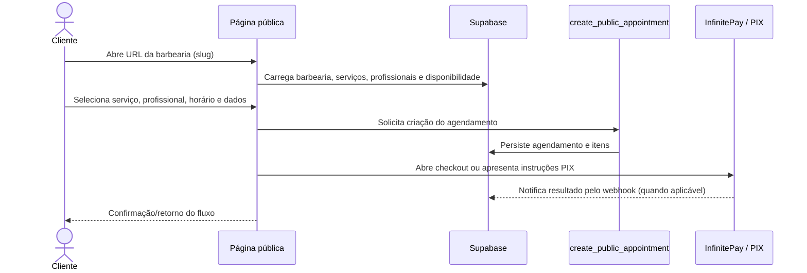

# Fluxos principais

## Agendamento público

As rotas `/book/:slug` e `/agendamentos/:slug` levam ao fluxo da página
`PublicBooking`. O cliente seleciona serviços e horário, informa seus dados e
envia a operação de criação ao RPC. O checkout InfinitePay hospedado é formado
no frontend com o identificador do agendamento como `order_nsu`. Há também a
Edge Function `create-pix-charge`, utilizada para o fluxo de geração de PIX.
Os caminhos disponíveis dependem do modo de pagamento configurado pela barbearia.

O banco mantém a criação do agendamento dentro de uma função SQL, serializa
reservas concorrentes por barbearia e inclui horários locais e reservas de
pagamento ainda válidas na verificação de conflito. A disponibilidade pública
é consultada por RPC limitada, sem leitura anônima direta da tabela de
agendamentos. A expiração também é aplicada por RPC condicional no servidor.

## Gestão da barbearia

1. O usuário autentica por Supabase Auth.
2. `AuthProvider` resolve as roles `admin` e `barber` em `user_roles`.
3. `useClinic` carrega a barbearia do proprietário, a barbearia associada ao
   profissional ou, para admin, uma barbearia em modo de impersonação.
4. `DashboardLayout` usa esse contexto para apresentar o painel e trata
   redirecionamentos, onboarding e estados de licença.
5. Páginas de módulo consultam e alteram dados pelo Supabase; RLS e funções no
   banco devem limitar essas operações ao escopo permitido.

O painel contém áreas de agenda, clientes, serviços, profissionais,
configurações, relatórios, pagamentos, caixa e PDV. A navegação e os módulos
estão registrados em `src/App.tsx` e nas subpáginas de `src/pages/dashboard/`.

## Profissional, comanda e PDV

O profissional é associado a uma barbearia por registros em `barbers`. O PDV e
as comandas operam sobre agendamentos, itens, caixa e vendas. As migrações
incluem tabelas de pagamentos, caixa e itens, além de funções para checkout,
aprovação de comissão, totais e auditoria.

O isolamento entre gestor, profissional e barbearia deve ser imposto pelas
políticas RLS e pelas funções SQL, não apenas pelos filtros de interface. Veja
as políticas efetivas no conjunto de migrações aplicado ao ambiente.

## Pagamento

Existem caminhos de pagamento relacionados, mas não idênticos:

- o fluxo público monta checkout InfinitePay e associa `order_nsu` ao
  agendamento;
- `create-pix-charge` pode gerar cobrança PIX usando credencial da barbearia ou
  retornar dados de PIX estático;
- `infinitepay-webhook` recebe eventos com um cabeçalho secreto configurado,
  exige valor e referência do pagamento, verifica o valor esperado da cobrança e
  registra o evento de forma idempotente em `appointment_payments`. O saldo
  acumulado fica em `appointments.amount_paid`; pagamentos parciais permanecem
  `partial` até que o total seja quitado e são descontados no fechamento do PDV.

O cabeçalho personalizado precisa ser suportado e configurado no painel
InfinitePay. Sem `INFINITEPAY_WEBHOOK_SECRET` ou sem o cabeçalho correto, o
webhook falha fechado e não confirma pagamentos. Não se presume validação
criptográfica nativa do provedor; detalhes em
[Segurança e operação](./05-seguranca-e-operacao.md).

## Atualização em tempo real

No painel, `useLiveAppointments` assina mudanças de agendamentos e clientes para
a barbearia corrente. Ao receber eventos, invalida consultas React Query; um novo
agendamento também produz toast e tenta tocar um arquivo de áudio. A solicitação
de permissão de notificação no navegador não significa que o código envie
notificações Web Push.
