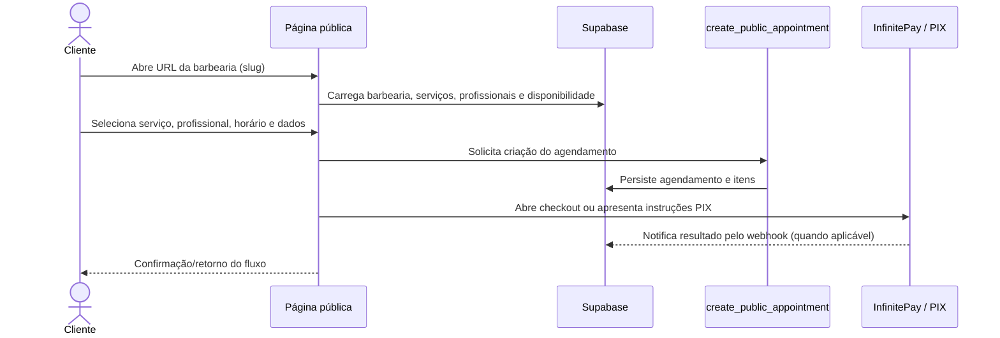

# Fluxos principais

## Agendamento público

As rotas `/book/:slug` e `/agendamentos/:slug` levam ao fluxo da página
`PublicBooking`. O cliente seleciona serviços e horário, informa seus dados e
envia a operação de criação ao RPC. O checkout InfinitePay hospedado é formado
no frontend com o identificador do agendamento como `order_nsu`. Há também a
Edge Function `create-pix-charge`, utilizada para o fluxo de geração de PIX.
Os caminhos disponíveis dependem do modo de pagamento configurado pela barbearia.

O banco mantém a criação do agendamento dentro de uma função SQL e possui
migrações de pagamento/expiração. As regras exatas de colisão, status e timeout
devem ser verificadas nas migrações aplicadas; a interface não é a autoridade
para garantir exclusividade do horário.

## Gestão da barbearia

1. O usuário autentica por Supabase Auth.
2. `AuthProvider` resolve as roles `admin` e `barber` em `user_roles`.
3. `useClinic` carrega a barbearia do proprietário, a barbearia associada ao
   profissional ou, para admin, uma barbearia em modo de impersonação.
4. `DashboardLayout` usa esse contexto para apresentar o painel e trata
   redirecionamentos, onboarding e estados de licença.
5. Páginas de módulo consultam e alteram dados pelo Supabase; RLS e funções no
   banco devem limitar essas operações ao escopo permitido.

O painel contém áreas de agenda, clientes, serviços, profissionais,
configurações, relatórios, pagamentos, caixa e PDV. A navegação e os módulos
estão registrados em `src/App.tsx` e nas subpáginas de `src/pages/dashboard/`.

## Profissional, comanda e PDV

O profissional é associado a uma barbearia por registros em `barbers`. O PDV e
as comandas operam sobre agendamentos, itens, caixa e vendas. As migrações
incluem tabelas de pagamentos, caixa e itens, além de funções para checkout,
aprovação de comissão, totais e auditoria.

O isolamento entre gestor, profissional e barbearia deve ser imposto pelas
políticas RLS e pelas funções SQL, não apenas pelos filtros de interface. Veja
as políticas efetivas no conjunto de migrações aplicado ao ambiente.

## Pagamento

Existem caminhos de pagamento relacionados, mas não idênticos:

- o fluxo público monta checkout InfinitePay e associa `order_nsu` ao
  agendamento;
- `create-pix-charge` pode gerar cobrança PIX usando credencial da barbearia ou
  retornar dados de PIX estático;
- `infinitepay-webhook` recebe eventos, confere status e valor conforme os
  dados do agendamento e registra tentativa de atualização.

O webhook aceita eventos HTTP sem autenticação JWT do gateway e o código atual
não valida uma assinatura criptográfica do provedor. Até essa validação ser
implementada e testada, não se deve descrever esse endpoint como autenticado
criptograficamente; detalhes em [Segurança e operação](./05-seguranca-e-operacao.md).

## Atualização em tempo real

No painel, `useLiveAppointments` assina mudanças de agendamentos e clientes para
a barbearia corrente. Ao receber eventos, invalida consultas React Query; um novo
agendamento também produz toast e tenta tocar um arquivo de áudio. A solicitação
de permissão de notificação no navegador não significa que o código envie
notificações Web Push.
